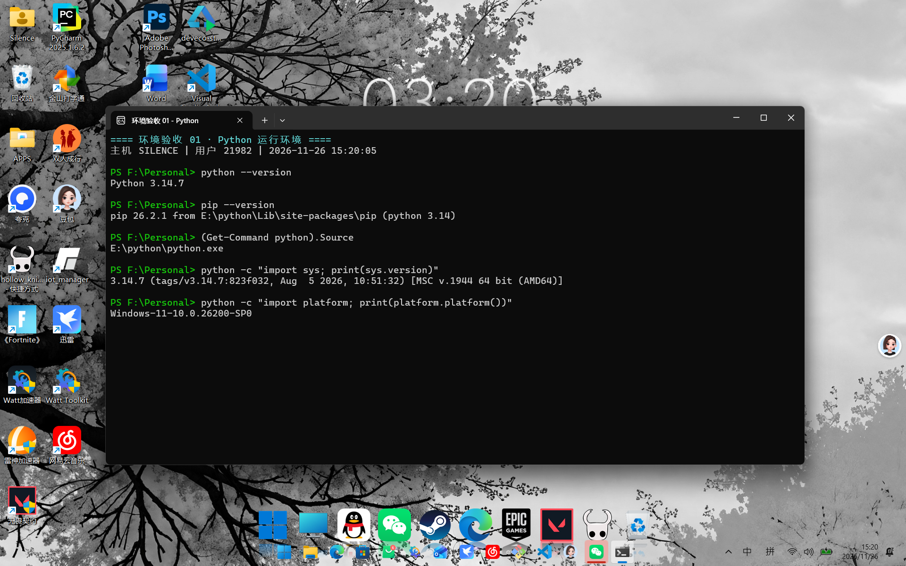
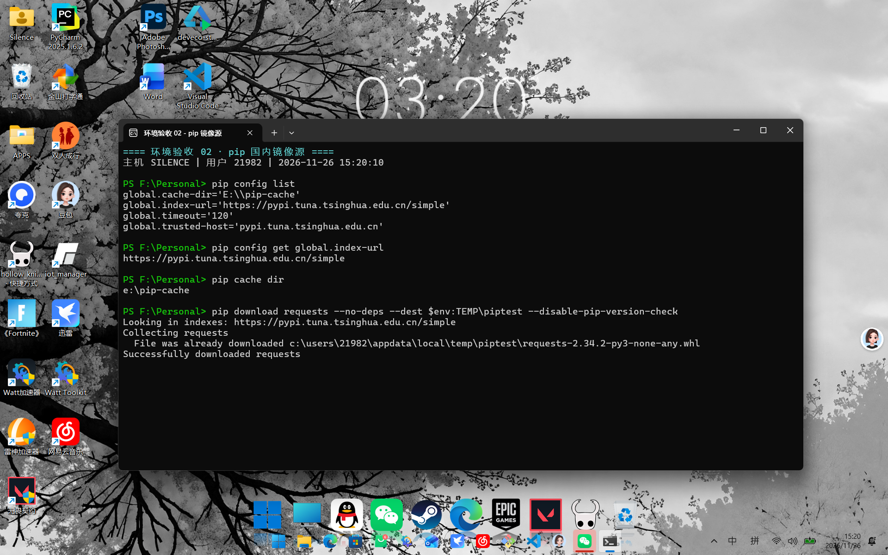
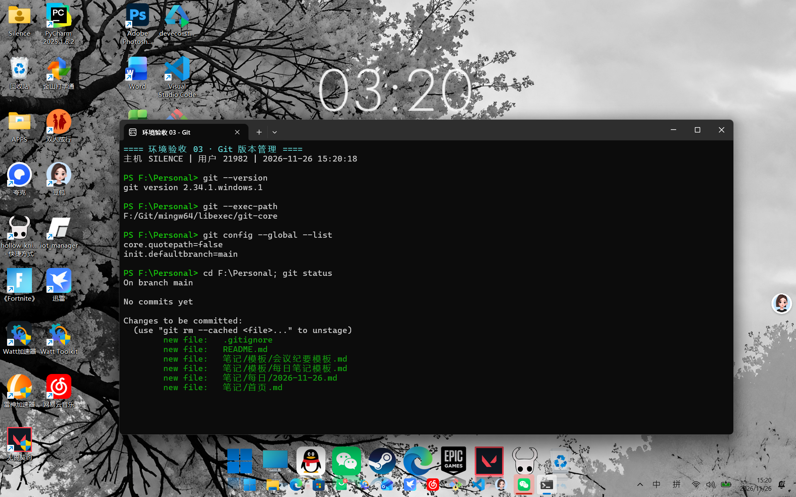
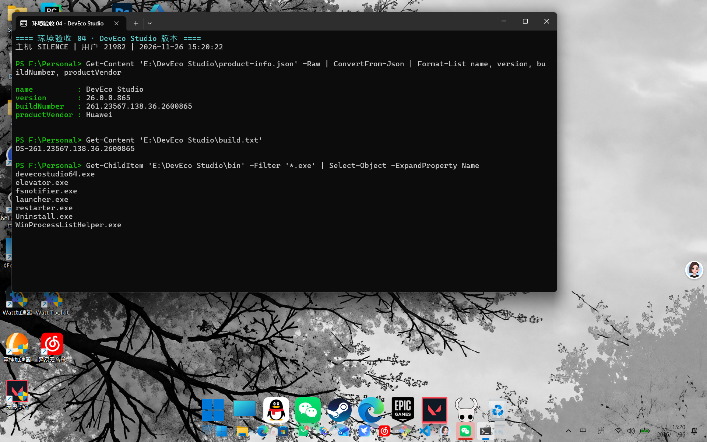
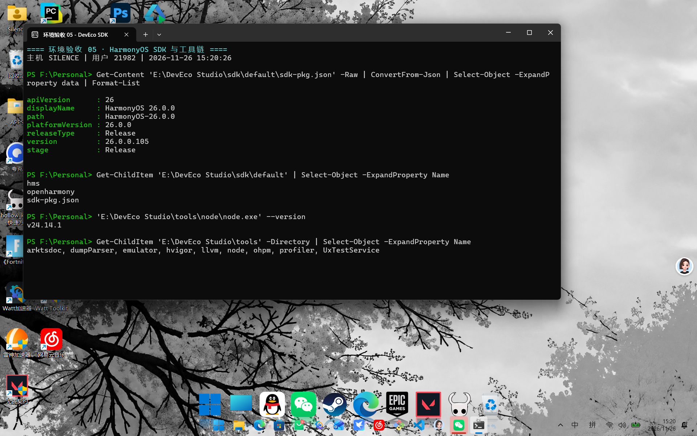

# 环境验收单

| 项目 | 内容 |
| --- | --- |
| 验收对象 | HarmonyOS 应用开发基础环境（Python / Git / DevEco Studio） |
| 验收人 | 何尧（计算机应用技术 263012 班） |
| 验收日期 | 2026-11-26 |
| 验收机器 | SILENCE（Windows 11，10.0.26200） |
| 验收方式 | 本机 PowerShell 命令行逐项实测，屏幕截图取证 |

> 验收人信息按已有资料预填，如有出入请直接修改。以下截图均为本机实时运行的真实终端画面，未做任何修图或拼接。

## 一、验收结果总览

| 序号 | 环境项 | 实测版本 / 路径 | 结论 |
| --- | --- | --- | --- |
| 1 | Python 解释器 | 3.14.7（`E:\python\python.exe`） | 通过 |
| 2 | pip 包管理器 | 26.2.1 | 通过 |
| 3 | pip 国内镜像源 | `https://pypi.tuna.tsinghua.edu.cn/simple`（清华） | 通过 |
| 4 | pip 缓存目录 | `E:\pip-cache` | 通过 |
| 5 | Git | 2.34.1.windows.1（`F:\Git`，已加入用户 PATH） | 通过 |
| 6 | 个人仓库 | `F:\Personal`，分支 `main`，首个提交 `280d0c1` | 通过 |
| 7 | DevEco Studio | 26.0.0.865（build 261.23567.138.36.2600865） | 通过 |
| 8 | HarmonyOS SDK | API 26 / platformVersion 26.0.0 / 26.0.0.105 | 通过 |
| 9 | DevEco 内置 Node.js | v24.14.1，含 ohpm、hvigor、llvm、emulator | 通过 |
| 10 | GitHub 远端仓库 | <https://github.com/hhyy0628/Personal>（Public） | 通过 |

## 二、验证记录

### 2.1 Python 运行环境

命令：

```powershell
python --version
pip --version
(Get-Command python).Source
python -c "import sys; print(sys.version)"
python -c "import platform; print(platform.platform())"
```

实测结果：Python 3.14.7（64-bit），解释器实际路径 `E:\python\python.exe`，pip 26.2.1 由该解释器提供，运行平台 Windows-11-10.0.26200-SP0。与预期一致。



### 2.2 pip 国内镜像源与缓存目录

命令：

```powershell
pip config list
pip config get global.index-url
pip cache dir
pip download requests --no-deps --dest $env:TEMP\piptest --disable-pip-version-check
```

实测结果：`index-url` 指向清华源，`lookup` 时 pip 明确打印 `Looking in indexes: https://pypi.tuna.tsinghua.edu.cn/simple`，`cache dir` 为 `e:\pip-cache`，`requests` 包下载成功。说明配置文件 `%APPDATA%\pip\pip.ini` 已生效，且下载不再走官方 PyPI。



### 2.3 Git 版本与个人仓库

命令：

```powershell
git --version
git --exec-path
git config --global --list
cd F:\Personal; git status
```

实测结果：git 2.34.1.windows.1，核心路径 `F:/Git/mingw64/libexec/git-core`；全局配置含 `core.quotepath=false`（中文文件名不乱码）、`init.defaultBranch=main`；`F:\Personal` 已在 `main` 分支完成初始化，中文路径在 `git status` 中正常显示。

截图拍摄时该仓库尚未提交（`No commits yet`），提交与推送在随后完成，记录见第三节。



### 2.4 DevEco Studio 版本

命令：

```powershell
Get-Content 'E:\DevEco Studio\product-info.json' -Raw | ConvertFrom-Json | Format-List name, version, buildNumber, productVendor
Get-Content 'E:\DevEco Studio\build.txt'
Get-ChildItem 'E:\DevEco Studio\bin' -Filter '*.exe' | Select-Object -ExpandProperty Name
```

实测结果：DevEco Studio 26.0.0.865，buildNumber 261.23567.138.36.2600865，厂商 Huawei；主程序 `devecostudio64.exe` 及其配套可执行文件齐全。



### 2.5 HarmonyOS SDK 与工具链

命令：

```powershell
Get-Content 'E:\DevEco Studio\sdk\default\sdk-pkg.json' -Raw | ConvertFrom-Json | Select-Object -ExpandProperty data | Format-List
Get-ChildItem 'E:\DevEco Studio\sdk\default' | Select-Object -ExpandProperty Name
'E:\DevEco Studio\tools\node\node.exe' --version
Get-ChildItem 'E:\DevEco Studio\tools' -Directory | Select-Object -ExpandProperty Name
```

实测结果：SDK 为 HarmonyOS 26.0.0（apiVersion 26，platformVersion 26.0.0，version 26.0.0.105，Release），目录含 `hms`、`openharmony`；内置 Node.js v24.14.1；工具链含 ohpm、hvigor、llvm、emulator、profiler、dumpParser、UxTestService 等。



## 三、仓库同步补充记录

1. **Git 提交身份**：已设置 `user.name = 何尧`、`user.email = 324539111+hhyy0628@users.noreply.github.com`（GitHub 分配的 noreply 地址，避免在提交记录里暴露私人邮箱），首个提交 `280d0c1` 已完成。

2. **推送排障**：首次 `git push` 报 `SSL certificate problem: unable to get local issuer certificate`，改用 Windows 系统证书库后恢复，已设置 `git config --global http.sslBackend schannel`。

3. **GitHub 远端仓库**：已创建 Public 仓库 <https://github.com/hhyy0628/Personal>，并完成首次推送。校验结果：本地 `main`、`origin/main`、远端 `refs/heads/main` 三者均指向 `280d0c1`，网页端已显示 `笔记/`、`README.md`、`.gitignore`。

4. **遗留项：hdc 可执行文件**：`E:\DevEco Studio\sdk` 全目录未检索到 `hdc.exe`，真机调试前需在 SDK Manager 中补装 toolchains 组件，或用模拟器（`tools\emulator`）先行验证。

## 四、验收结论

Python、pip（含国内镜像源与缓存目录迁移）、Git、DevEco Studio、HarmonyOS SDK 及 GitHub 远端仓库共 10 项均在本机实测通过，版本与路径符合预期，仓库已成功同步至远端，具备进行 HarmonyOS 应用开发的基础条件。

唯一遗留事项为 SDK 内未包含 `hdc`，不影响编码、预览与模拟器调试，真机联调前补装即可。

- 验收人签字：________________
- 复验人签字：________________
- 日期：2026-11-26
